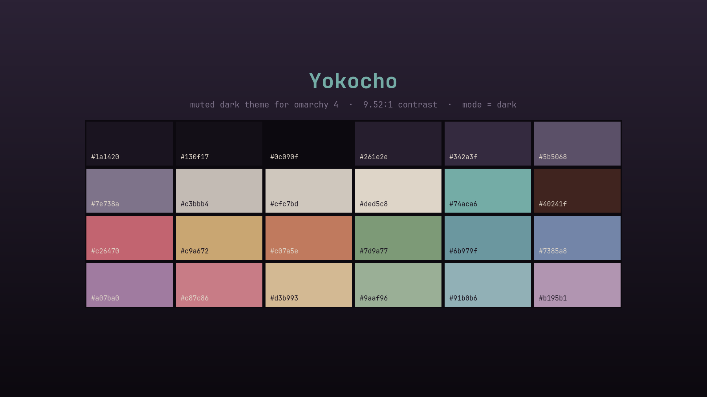

# Yokocho

A muted dark theme for [Omarchy](https://omarchy.org) 4 (Quattro), named for the narrow
back-alley it was drawn from: paper lanterns and neon over a wet cyberpunk side street.

Plum-black rather than blue-black, and the only theme of the set with a **teal accent**
against a **crimson** red — the wet street and the neon, which sit on opposite sides of
the wheel and so never get confused with one another.



## Install

```bash
omarchy theme install https://github.com/LizinDev/omarchy-yokocho-theme.git
```

Installing applies the theme right away. To switch back to it later, run
`omarchy theme set yokocho`; to uninstall it, run `omarchy theme remove yokocho`.

## Palette

| Role | Hex | |
|---|---|---|
| background | `#1a1420` | terminals, bar, popups, menus |
| foreground | `#c3bbb4` | all body text — 9.52:1 on background |
| accent | `#74aca6` | borders, shortcuts, selected rows |
| selection | `#342a3f` | text selection, btop meters |
| muted | `#5b5068` | ANSI bright-black, dividers |

ANSI: `#c26470` red · `#7d9a77` green · `#c9a672` yellow · `#7385a8` blue ·
`#a07ba0` magenta · `#6b979f` cyan.

Mean ANSI saturation is 0.34, matching the rest of the set. The source image runs at
0.45, so the warm neon has been pulled down hard while keeping its hue.

The border gradient runs teal → crimson (`accent` → `red`). Because the accent is cool and `red` is warm,
they sit **61 dE apart** — a focused window border and a wrong-password border can never
be mistaken for each other, which is not automatic: two earlier themes in this set had
to be corrected for exactly that collision.

## What's here

| File | |
|---|---|
| `colors.toml` | the palette — generates 17 app configs on its own |
| `hyprland.lua` | teal→crimson border gradient + a cool shadow on the focused window |
| `shell.{menu,launcher,tooltip,lock}.toml` | per-section shell overrides |
| `icons.theme` | `Yaru-prussiangreen-dark` |
| `backgrounds/` | a palette-derived gradient (see below) |
| `preview.png` | theme-switcher tile |
| `unlock.png` | Plymouth boot splash and SDDM logo |

## Backgrounds

Only `3-yokocho-void.png` ships here — a plain gradient generated from the palette. The
theme was designed against a piece of pixel art, but that is someone else's work and is
not redistributed. Drop your own in:

```bash
cp <your-wallpaper> ~/.config/omarchy/themes/yokocho/backgrounds/1-yokocho.png
omarchy theme set yokocho
```

If yours is a JPEG of pixel art, check whether it is an integer upscale before doing
anything to it. Round-trip `-filter point` down by N and back up; if one N is clearly
best *and* offset 0 beats offset 1, there is a real grid to restore to. If every N and
both phases score about the same, the art is native — downsampling would destroy real
detail, and a plain full-resolution requantize is the only safe clean-up:

```bash
magick wall.jpg +dither -colors 160 wall-clean.png
```

That is what happened here: 153,142 colours of JPEG damage over native 1920×1080 art,
reduced to 160 while keeping 89% of the artist's dither transitions.

## Caveats

**Installed from a git clone, this theme loses `hyprland.lua`.** Omarchy drops every
`.lua`, terminal config and `vscode.json` from a cloned theme, because each names
something to run. The palette and the border gradient survive — they live in
`colors.toml` — but not the window shadows.

**`shell.*.toml` overrides replace their whole section, they don't merge.** Each file
here restates the complete section, and its hex values are frozen copies of
`colors.toml`. Re-sync them if you change the palette — `shell.lock.toml` in particular
carries `red` twice, as `text-error` and `border-error`.

## Working on it

Keep the repo outside `~/.config/omarchy/themes` and symlink it in. A directory with a
`.git` inside is treated as somebody else's theme and staged under restrictions; a
symlink is not.

```bash
git clone <this-repo> ~/Projects/omarchy-yokocho-theme
ln -s ~/Projects/omarchy-yokocho-theme ~/.config/omarchy/themes/yokocho
omarchy theme set yokocho
```

Iterate with `omarchy theme refresh`.

## License

The theme files are released under the [MIT License](LICENSE). The pixel art the palette
was designed against is someone else's work. It is not in this repository and the
license does not cover it.
